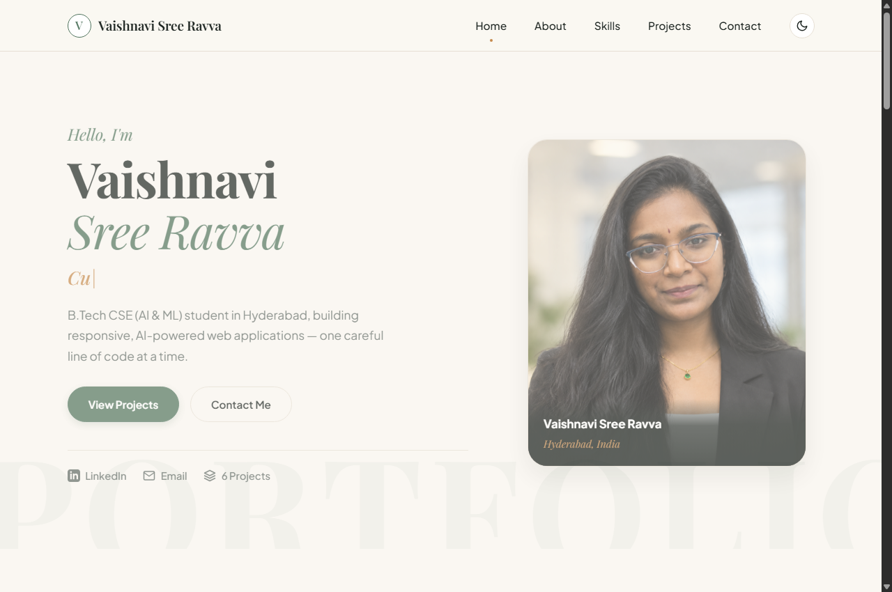
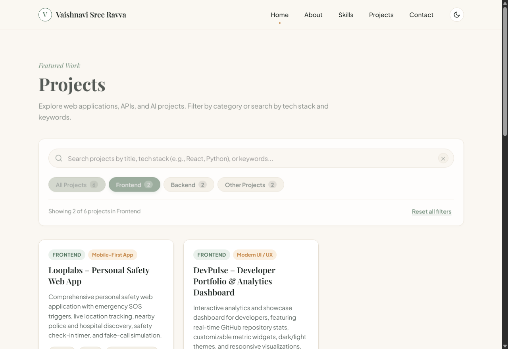
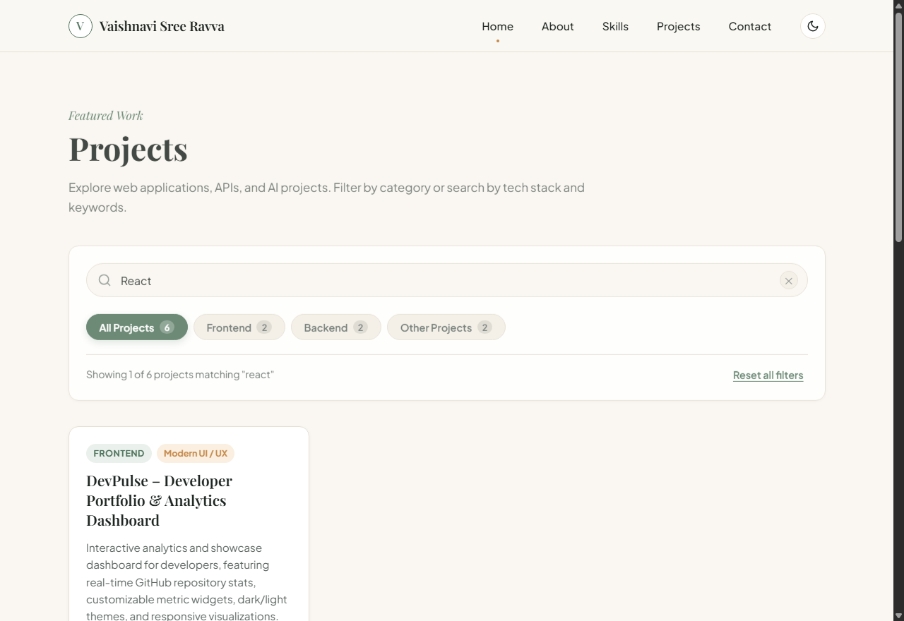
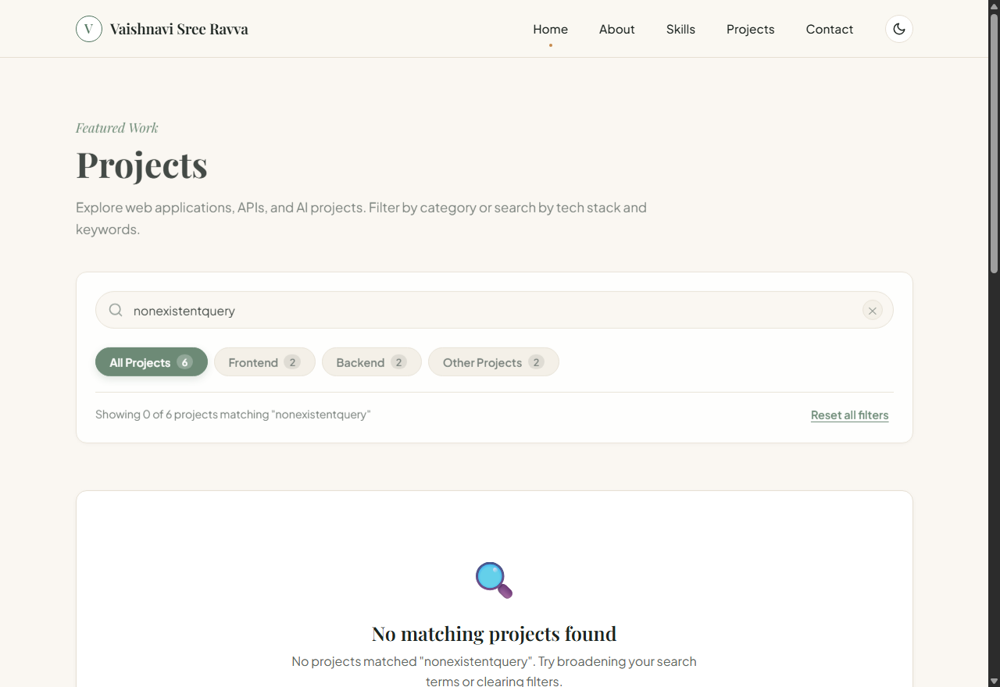
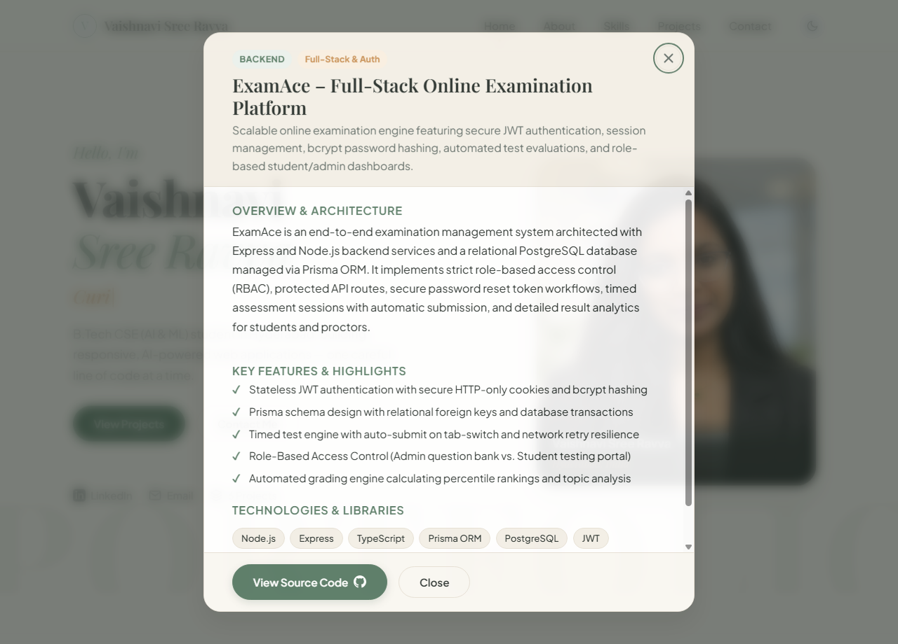
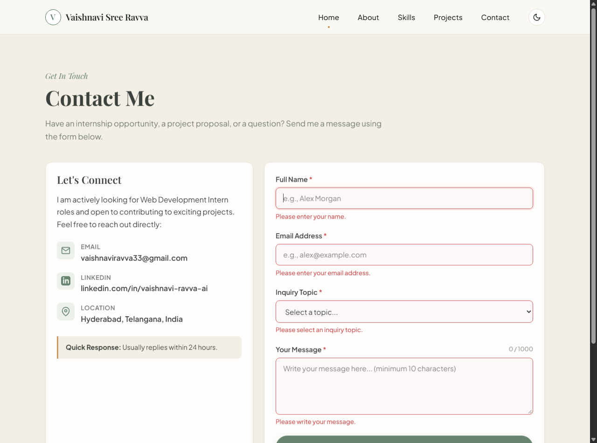
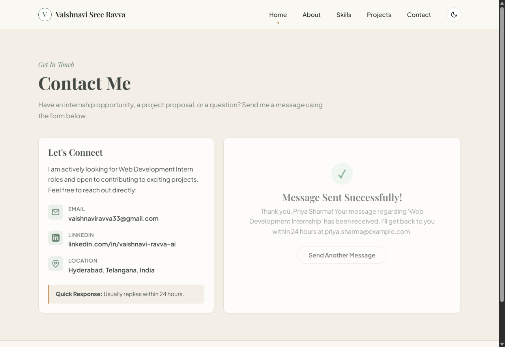
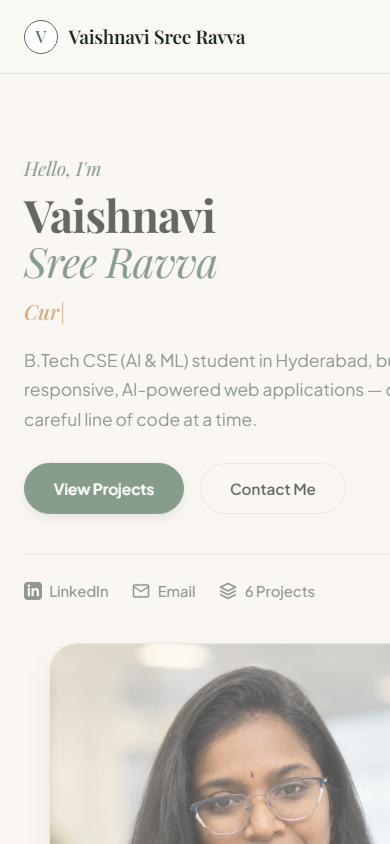
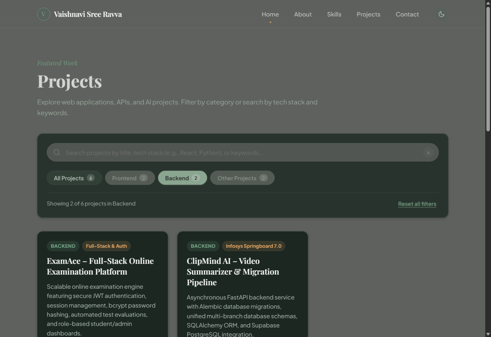

# Vaishnavi Sree Ravva – Web Developer Portfolio

A responsive personal developer portfolio built with semantic **HTML5**, modern **CSS3**, and vanilla **JavaScript (ES6+)**. The portfolio features a **Warm Cream Editorial Aesthetic** matching the design reference, with serif typography (`Playfair Display`), sage green accents, a hero profile showcase, real-time project filtering, search, modal previews, and a validated contact form.

---

## 🎨 Theme & Aesthetic Transformation

- **Warm Cream & Editorial Palette:** Built with a soothing linen background (`#faf7f2`), crisp white card surfaces, soft neutral borders (`#e6dfd3`), sage green accents (`#4f735c`), and warm ochre highlights (`#c68a4c`).
- **Typography Hierarchy:** Uses Google Fonts pairing of **Playfair Display** (editorial serif for headings and hero greeting) and **Plus Jakarta Sans** (clean, modern sans-serif for readability).
- **Two-Column Hero Layout:**
  - **Left Column:** Elegant greeting (*"Hello, I'm"*), two-tone headline (*"Vaishnavi"* in dark serif, *"Sree Ravva"* in sage green italic serif), dynamic typewriter tagline (*"Curious mind."*), bio description, and pill-shaped action buttons (*"View Projects"* and *"Contact Me"*).
  - **Right Column:** Rounded portrait card featuring Vaishnavi's photograph with subtle shadow and a floating gradient badge (*"Vaishnavi Sree Ravva – Hyderabad, India"*).
  - **Watermark:** Faint large background typography (`PORTFOLIO`) for depth and brand identity.
- **Dark/Light Mode:** Includes an interactive theme toggle in the navigation bar that seamlessly transitions between the warm cream daytime theme and a refined deep-slate night theme.

---

## 🌟 Key Features Implemented

### 1. 📂 Project Filtering by Category
- **Category Filter Tabs:** Filter projects dynamically across **All Projects**, **Frontend**, **Backend**, and **Other Projects** (AI & ML / Generative AI tools).
- **Dynamic Count Badges:** Each tab displays a live counter showing the exact number of matching projects.
- **Visual State:** Active pill button with smooth transitions and responsive wrapping.

### 2. 🔍 Real-Time Project Search
- **Instant Search:** Filters projects as the user types by matching across titles, short descriptions, full architecture narratives, technology tags, and category labels.
- **Clear Action (`✕`):** One-click clear button resets the search field immediately.
- **Status Indicator:** Displays dynamic counts (e.g., *"Showing 2 of 6 projects in Frontend"*).
- **Graceful Empty State:** When no projects match, an empty state card appears with an explanation and a **"Reset Search & Filters"** button.

### 3. 🪟 Interactive Project Detail Modal (Demo Links Removed)
- **Focused Code & Architecture View:** As requested, demo links have been removed. Cards feature **"View Details"** and **"Source Code"** buttons.
- **Rich Popup Dialog:** Clicking **"View Details"** opens an accessible modal with a frosted glass backdrop (`backdrop-filter: blur(8px)`).
- **Complete Project Metadata:**
  - Category pill and highlight badge (e.g., *Infosys Springboard 7.0*, *Mobile-First App*)
  - Problem statement, architectural overview, and design decisions
  - Key highlights checklist with custom checkmarks
  - Technology stack pill tags
  - Direct link to **Source Code (GitHub)** (no demo link)
- **Full Accessibility:**
  - Closes via header close button (`✕`), footer Close button, clicking outside the overlay, or pressing the `Escape` key.
  - Automatically restores focus to the triggering button upon dismissal.
  - Locks background page scrolling (`body.modal-open`).
- **Form Fields:**
  - **Full Name:** Validates required state, minimum 2 characters, and alphabetic formatting.
  - **Email Address:** Validates required state and strict RFC email format regex.
  - **Inquiry Topic:** Required select dropdown covering Internship Opportunities, Collaborations, and General Questions.
  - **Your Message:** Validates required state, minimum 10 characters, and includes a live character counter (`0 / 1000`).
- **Interactive Feedback:**
  - Validates on `blur` (leaving field) without premature nagging while typing.
  - Clears error styling dynamically on `input` as soon as the user corrects the input.
  - Visual indicators: green border on valid fields; red border and descriptive error text on invalid fields.
- **Asynchronous Submission Experience:**
  - Submit button transitions into an interactive loading spinner (`"Sending message..."`).
  - Upon successful validation, renders a personalized confirmation banner:
    > *"Thank you, [Name]! Your message regarding '[Topic]' has been received. I'll get back to you within 24 hours at [Email]."*
  - Includes a **"Send Another Message"** reset button.
  - Simulates persistence by storing inquiries in browser `localStorage`.

### 5. 🎨 UI Polish, Dark/Light Mode & Responsiveness
- **Theme Toggle:** Persistent dark/light theme switch stored in `localStorage` and adhering to `prefers-color-scheme`.
- **Glassmorphic Navigation:** Sticky navbar with blur backdrop and active scrollspy link indicators.
- **Mobile Navigation:** Responsive hamburger menu with smooth slide-down animation and touch targets.
- **Floating Back-to-Top Button:** Appears automatically when scrolling past 350px.
- **URL Deep Linking:** Supports URL search parameters for sharing and testing states:
  - `?category=frontend`
  - `?search=React`
  - `?modal=examace`
  - `?theme=light` or `?theme=dark`

---

## 📸 Screenshots Showcase

| View | Screenshot |
| :--- | :--- |
| **Desktop Hero & Navbar** |  |
| **Category Filtering** |  |
| **Live Search** |  |
| **Search Empty State** |  |
| **Project Detail Modal** |  |
| **Contact Form Validation** |  |
| **Contact Submission Success** |  |
| **Mobile Viewport (390px)** |  |
| **Dark Mode Theme** |  |

---

## 📂 Project Structure

```text
portfolio/
├── index.html           # Semantic HTML5 structure with Warm Cream editorial layout
├── style.css            # CSS custom properties, responsive grid, pill styling & modal
├── script.js            # Modular JavaScript: data, filters, search, modal & validation
├── take_screenshots.py  # Automated screenshot capture script (headless Chrome)
├── capture_shots.ps1    # PowerShell screenshot runner
├── README.md            # Comprehensive documentation and feature guide
├── assets/
│   └── profile.png      # User's portrait headshot card image
└── screenshots/         # Submission showcase screenshots
    ├── 01-desktop-hero.png
    ├── 02-projects-filtering.png
    ├── 03-projects-search.png
    ├── 04-projects-empty-state.png
    ├── 05-project-modal.png
    ├── 06-contact-validation.png
    ├── 07-contact-success.png
    ├── 08-mobile-view.png
    └── 09-dark-mode.png
```

---

## 🚀 How to Run Locally

You can run the portfolio locally without installing extra dependencies:

### Option 1: Python HTTP Server (Recommended)
```bash
# In the portfolio directory:
python -m http.server 8080
```
Then open [http://localhost:8080](http://localhost:8080) in your web browser.

### Option 2: Node.js (npx serve)
```bash
npx serve .
```

### Option 3: Direct Browser Launch
Double-click `index.html` to open it directly in any modern browser (Chrome, Edge, Firefox, Safari).

---

## 🧪 Verification & Testing Completed

1. **Category Filter Testing:** Verified clicking *All Projects*, *Frontend*, *Backend*, and *Other Projects* filters cards correctly and updates counter badges.
2. **Search Testing:** Verified keyword queries (e.g., `React`, `Python`, `Leaflet`) filter cards immediately, case-insensitively, and clearing restores cards.
3. **Empty State Testing:** Verified unmatched searches trigger the empty state card and the *"Reset Search & Filters"* button restores full state.
4. **Modal Testing:** Verified clicking *"View Details"* opens the dialog with complete overview, features, and tags. Verified closing via `X`, footer close button, backdrop click, and `Escape` key.
5. **Form Validation Testing:** Verified empty submission highlights all fields with specific error messages; verified invalid email detection (`test@`); verified message length enforcement; verified successful submission displays confirmation card and loading state.
6. **Theme Testing:** Verified dark and light mode toggle updates colors smoothly and persists across reloads.
7. **Responsiveness Testing:** Verified layout across desktop (1280px), tablet (768px), and mobile (390px) screen viewports.

---

## 📤 GitHub Submission Instructions

To push this codebase to your GitHub repository:

```bash
# 1. Initialize remote (replace with your repository URL)
git remote add origin https://github.com/vaish210826/portfolio.git

# 2. Rename branch to main if needed
git branch -M main

# 3. Push source code and screenshots
git push -u origin main
```
